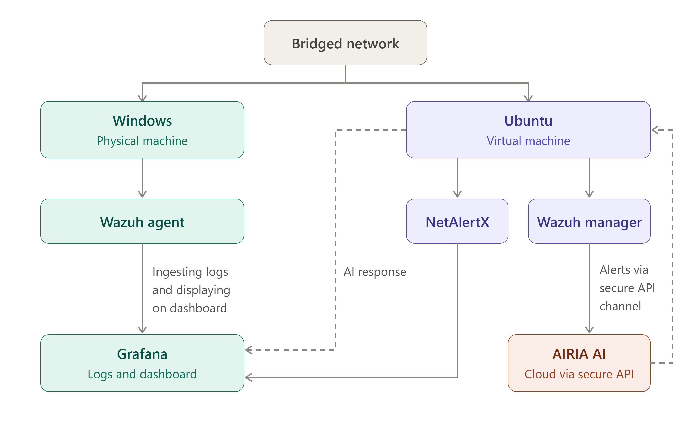

# 🛡️ SentinelFlow AI SOC (`sentinelflow-ai-soc`)


**SentinelFlow AI SOC** is a hybrid, multi-node Security Operations Center (SOC) lab and telemetry pipeline designed to unify endpoint File Integrity Monitoring (FIM), real-time LAN asset discovery, centralized SIEM visualization, and planned AI-driven autonomous alert triage.

Built across a bridged Windows 11 physical workstation and an Ubuntu Server virtual machine (`192.168.0.50`), SentinelFlow integrates **Wazuh v4.14.10**, **NetAlertX**, and **Grafana** into a single pane of glass, with an architectural roadmap for **Airia AI** agentic triage and automated response.

---

## 🏗️ System Architecture



### Network & Node Topology
| Node / Component | Host Environment | IP / Endpoint | Role & Function |
| :--- | :--- | :--- | :--- |
| **Windows 11 Workstation** | Physical Host (`DESKTOP-HOQHBSK`) | `192.168.0.102` | Monitored endpoint running Wazuh Agent v4.14.10 with real-time `syscheck` FIM on `E:\Personal Projects\sentinelflow-ai-soc\monitored_directory`. |
| **Wazuh Manager & Indexer** | Ubuntu VM (`node01`) | `https://192.168.0.50:9200` | Central SIEM engine, rule evaluator, and OpenSearch alert store (`wazuh-alerts-*`). |
| **NetAlertX** | Ubuntu VM (Docker/Service) | `http://192.168.0.50:20212` | Continuous network scanner (`ARPSCAN` every 5 mins) tracking MAC/IP bindings, new devices, and device presence. |
| **Grafana Unified SOC** | Ubuntu VM | `http://192.168.0.50:3000` | Unified visualization layer (`SentinelFlow_AI_SOC`, UID: `adktrrf`) combining OpenSearch and Infinity JSONata datasources. |
| **Airia AI (Roadmap)** | Cloud API Integration | Secure REST Webhook | Planned Phase 3 autonomous SOC analyst for alert enrichment, MITRE ATT&CK mapping, risk scoring, and automated containment. |

---

## 📂 Repository Structure

```text
sentinelflow-ai-soc/
├── README.md                                      # Comprehensive project documentation & setup guide
├── notebooks/
│   └── SentinelFlow_AI_SOC_End_to_End_Guide.ipynb # Interactive Jupyter Notebook covering full build, logs, troubleshooting & Airia AI roadmap
├── docs/
│   ├── ARCHITECTURE.md                            # Deep-dive technical architecture & data flow specifications
│   └── AIRIA_AI_FUTURE_WORK.md                    # Phase 3 Airia AI agentic triage, webhook pipeline & future research roadmap
├── configs/
│   ├── wazuh/
│   │   └── ossec_fim_snippet.xml                  # Windows Agent real-time FIM (syscheck) configuration
│   └── netalertx/
│       └── arpscan_settings.conf                  # NetAlertX ARPSCAN scheduling & watched columns configuration
├── grafana/
│   ├── dashboards/
│   │   └── SentinelFlow_AI_SOC.json               # Production-ready Grafana dashboard JSON (UID: adktrrf)
│   └── provisioning/
│       ├── datasources/
│       │   └── datasources.yaml                   # Grafana provisioning for OpenSearch (Wazuh) & Infinity (NetAlertX)
│       └── dashboards/
│           └── dashboards.yaml                    # Automatic Grafana dashboard loader configuration
├── scripts/
│   ├── fim_validation_test.ps1                    # PowerShell script to generate create/modify/delete FIM telemetry
│   └── patch_grafana_dashboard.py                 # Python utility to programmatically validate/patch Grafana panel queries via API
├── airia_integration/
│   ├── wazuh_airia_webhook.py                     # Custom Wazuh integration script (`custom-airia`) forwarding alerts to Airia AI
│   └── airia_response_schema.json                 # Target JSON schema for Airia AI risk score & alert summary ingestion into Grafana
└── images/                                        # Complete visual build log (Screenshots 01–19 + Workflow Diagram)
```

---

## 🚀 End-to-End Implementation Summary

### Phase 1: Endpoint Telemetry & Wazuh FIM (`ossec.conf`)
1. **Agent Enrollment:** Enrolled physical host `DESKTOP-HOQHBSK` (`192.168.0.102`, Agent ID `001`) into Wazuh Manager v4.14.10 (`192.168.0.50`).
2. **Real-Time Syscheck:** Enabled real-time monitoring (`realtime="yes" check_all="yes" report_changes="yes"`) on `E:\Personal Projects\sentinelflow-ai-soc\monitored_directory` inside `ossec.conf`.
3. **Adversarial Validation:** Executed `scripts/fim_validation_test.ps1` to simulate file creation (`Rule 554`, Level 5), checksum modification (`Rule 550`, Level 7), and file deletion (`Rule 553`, Level 7), confirming 18+ real-time FIM events in Wazuh Dashboard.

### Phase 2: Network Discovery & Unified Grafana Dashboard
1. **NetAlertX ARPSCAN:** Configured `ARPSCAN` (`*/5 * * * *`) on the bridged subnet (`192.168.0.0/24`), discovering **9 active network devices** (`Ubuntu`, `_gateway`, and local endpoints).
2. **Grafana Datasources:**
   - **Wazuh Indexer (`SentinelFlow-Wazuh-Indexer-2`):** Connected via Grafana OpenSearch plugin to `https://192.168.0.50:9200` (`wazuh-alerts-*`, time field `@timestamp`).
   - **NetAlertX API (`NetAlertX Infinity`, UID `cg5b0m1omr6kgb`):** Connected via Grafana Infinity plugin to `http://192.168.0.50:20212/devices`.
3. **Dashboard Engineering (`SentinelFlow_AI_SOC`):**
   - Resolved Infinity JSONata root/column mapping issues where empty `devStatus` predicates yielded `null` frames.
   - Configured **FIM events** (`793–796` events), **File integrity events** live table, **Online devices** stat counter (`9`), **Device inventory** table, and **Device status** breakdown.

### Phase 3: Future Work — Airia AI Autonomous SOC Integration
The dashboard already includes dedicated placeholders (**Latest Airia risk** and **Latest alert name**) engineered for the upcoming **Airia AI** integration:
- **Webhook Alert Forwarding:** `airia_integration/wazuh_airia_webhook.py` intercepts high-severity Wazuh alerts (`level >= 7`) and streams JSON payloads over a secure API channel to an Airia AI agent pipeline.
- **LLM Triage & MITRE Mapping:** Airia AI correlates endpoint FIM hashes with NetAlertX device reputation, assigns a normalized `0–100` risk score, maps TTPs to MITRE ATT&CK, and generates plain-English remediation playbooks.
- **Closed-Loop Feedback:** Airia AI writes enriched verdicts back to an OpenSearch index (`airia-triage-*`) or REST endpoint, populating the **Latest Airia risk** and **Latest alert name** panels in real time.

---

## 🛠️ Quick Start & Reproduction

1. **Configure Wazuh FIM:** Merge `configs/wazuh/ossec_fim_snippet.xml` into `C:\Program Files (x86)\ossec-agent\ossec.conf` and restart the Wazuh service (`Restart-Service WazuhSvc`).
2. **Run FIM Validation:** Execute `powershell -ExecutionPolicy Bypass -File scripts/fim_validation_test.ps1`.
3. **Import Grafana Dashboard:** Import `grafana/dashboards/SentinelFlow_AI_SOC.json` into Grafana (`http://192.168.0.50:3000`) and map your OpenSearch and Infinity datasources.
4. **Explore the Full Notebook:** Open `notebooks/SentinelFlow_AI_SOC_End_to_End_Guide.ipynb` in Jupyter or VS Code for the complete visual walkthrough, architecture notes, and Airia AI prototype code.

---

## 👤 Author
**Ragib Nadim** — Department of Computer Science, American International University-Bangladesh (AIUB)  
*Cybersecurity Researcher & SOC Engineering Enthusiast*
